# Interface: the embedded panel inside the EHR

> **Orders (OpenEMR brief, T6 sub-step 4, 2026-11-17).** The Orders tab is shown in [its own section](#orders-the-orders-tab-t6-sub-step-4), with screenshots from the same real OpenEMR 7.0.3 frame.
>
> **Status (OpenEMR brief, T5, 2026-11-16).** The screenshots in `after/` were taken **inside a real OpenEMR 7.0.3 frame** (Docker), not on the synthetic staging that the older ones came from. What they show and what they do not is below. The old staging screenshots are kept in [`archive-staging/`](archive-staging/) with their own note, because the staging mode (and the labels "Synthetic data" and "No AI inference" on them) no longer exists.

## Screenshots taken inside OpenEMR

**How.** `tests/e2e/browser/openemr-frame.mjs` signs in to OpenEMR 7.0.3, opens the chart of a patient created in that OpenEMR for testing (fictional: a name, an allergy, two problems, one medication, a visit), presses the app's own **Launch** button, signs in and authorizes in OpenEMR's own pages, and captures the frame OpenEMR opens. StethoLink was the production build; Chromium 153 (Playwright), 2x pixel density; the frame was narrowed to 360 or 420 CSS pixels for the narrow shots (the script checks that the page then has no sideways scroll). The registration was a different site from OpenEMR (`127.0.0.1` against `localhost`), so the session cookie was `SameSite=None; Secure; HttpOnly; Partitioned` (`COOKIE_MODE=embedded`). The same script checked on every run that no window or tab opened, that StethoLink asked for nothing outside its own origin and that every response carried the policy; the commands are in [openemr.md, 5a](../openemr.md).

**The panel inside the OpenEMR window**

| 1280 px window | 360 px panel in the same window |
| --- | --- |
| 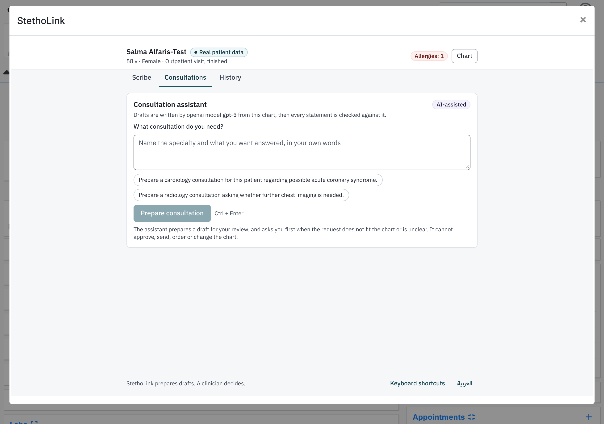 |  |

**Chart and work area, 360 px, English and Arabic (right to left)**

| English, chart open | Arabic, chart open | English | Arabic |
| --- | --- | --- | --- |
|  |  |  | 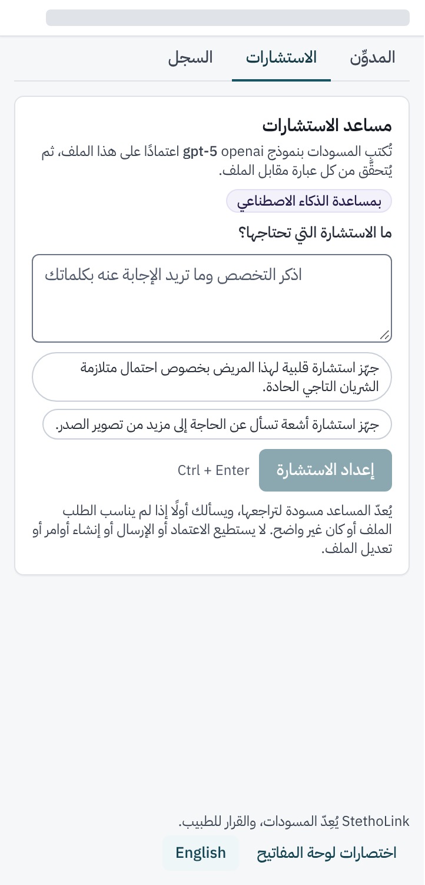 |

Wide (the full width of OpenEMR's dialog): 

**States**

| No open visit (English) | No open visit (Arabic) | A part of the chart the EHR did not grant | The same, Arabic |
| --- | --- | --- | --- |
|  | 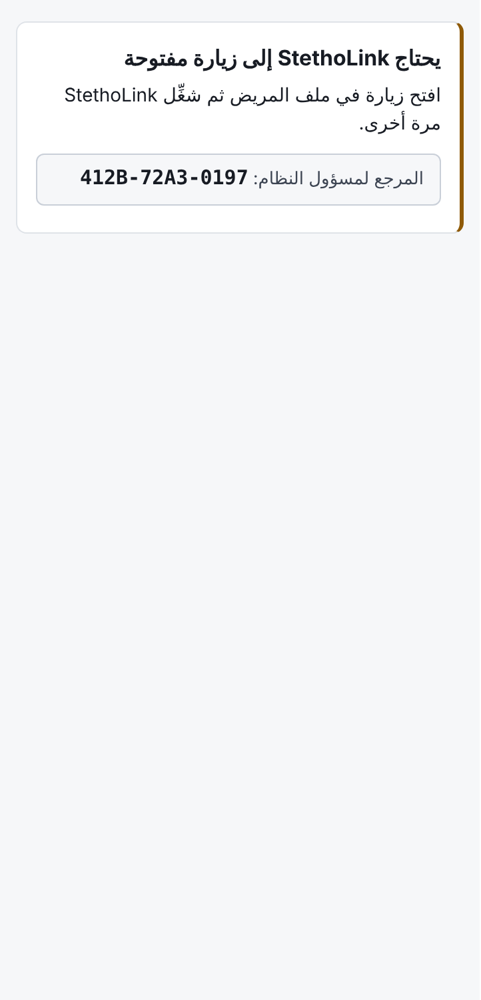 |  | 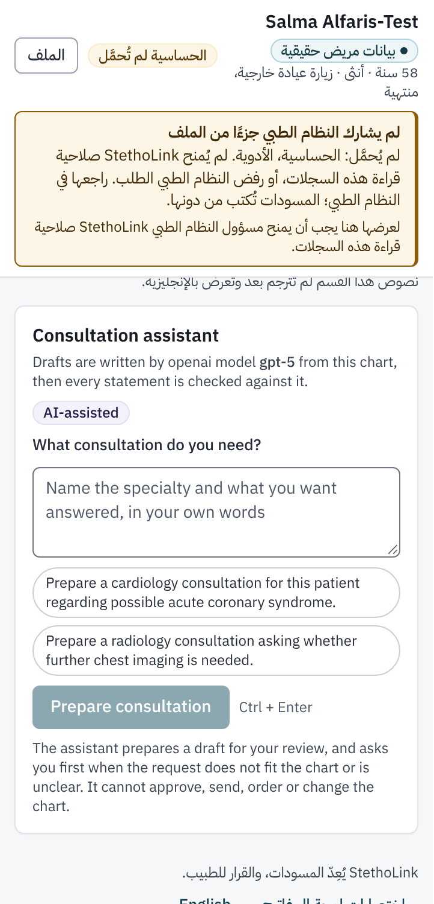 |

| Server error with its reference | Microphone not allowed in OpenEMR's frame |
| --- | --- |
| 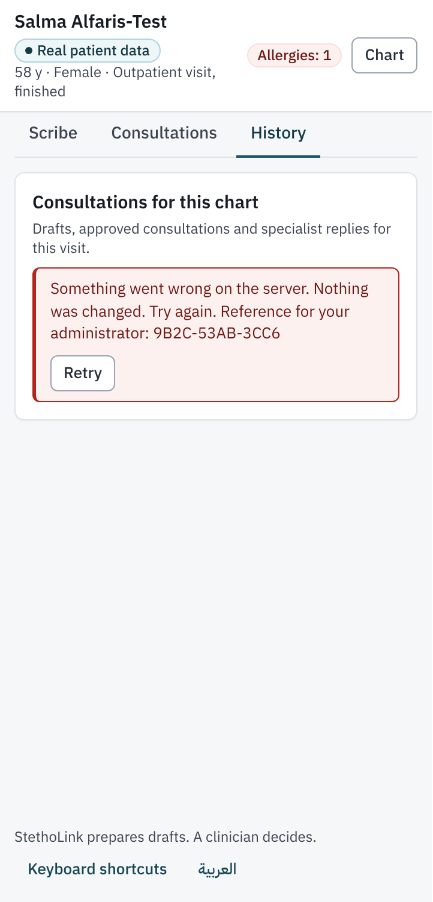 | 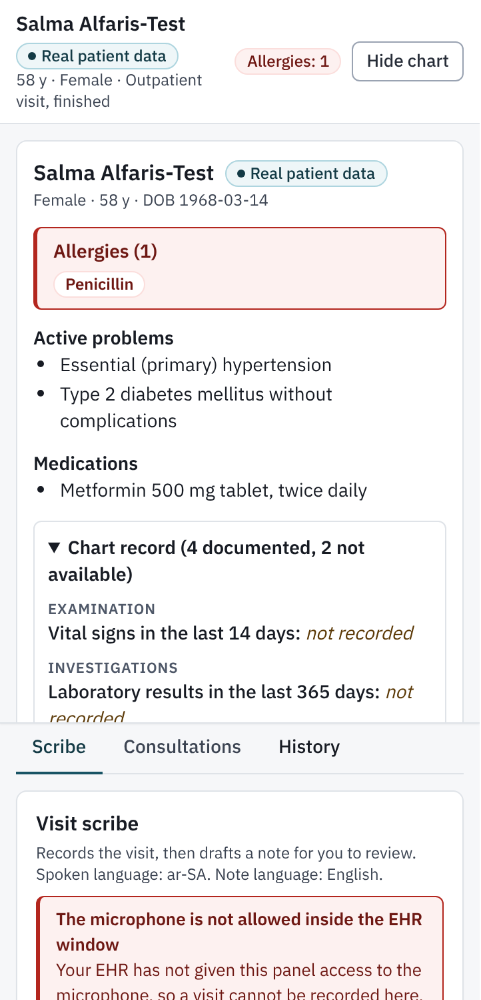 |

- *No open visit:* the page the launch ends on when the chart has no open visit (T1). The reference is the one in the server log line.
- *Not granted:* a second SMART client was registered without `patient/AllergyIntolerance.read` and `patient/MedicationRequest.read`. The patient bar says "Allergies not loaded" and a notice names what was not loaded and who can change it; the allergy box no longer reads "None recorded".
- *Server error:* the database was stopped while the History tab was open. The server logged `api.request_failed` with the same reference (`9B2C-53AB-3CC6` in this run).
- *Microphone:* OpenEMR 7.0.3 creates the frame without `allow="microphone"`, so the browser refuses it. The panel says so and offers nothing else (it used to offer a new window).

**A consultation from the real model, 420 px.** The visit reason says chest pain; the request was typed in the panel; the model was OpenAI `gpt-5` through the de-identification layer (T4), a few cents for the whole sequence. It asked twice before drafting (the first answer was vague), then "Prepare anyway" drafted it with its doubts kept visible. Approval needs a mapped physician, a destination from the tenant's list and a confirmation that says what it does; nothing was sent to a specialist.

| The assistant questions the request | The draft | Approval dialog | After approval |
| --- | --- | --- | --- |
| 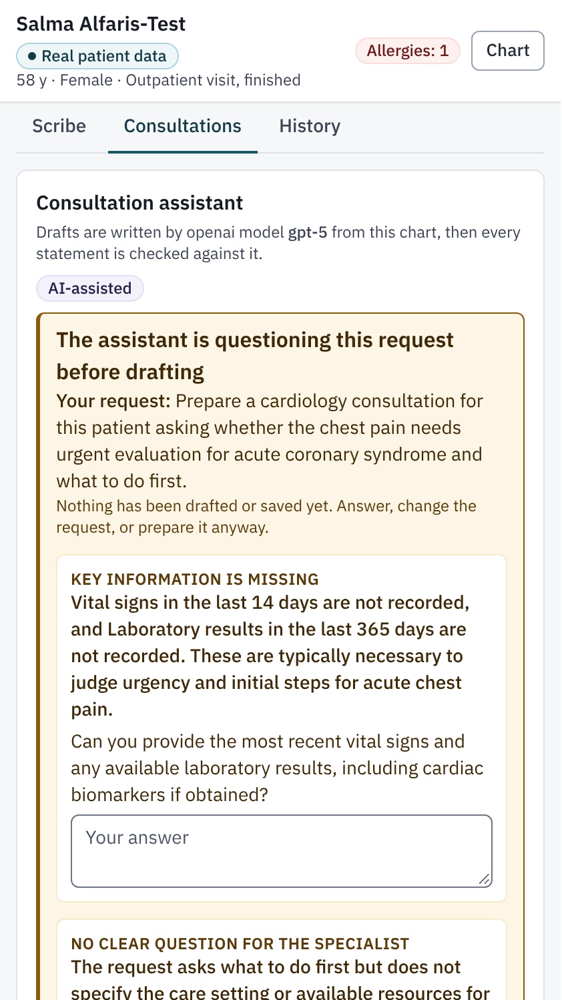 | 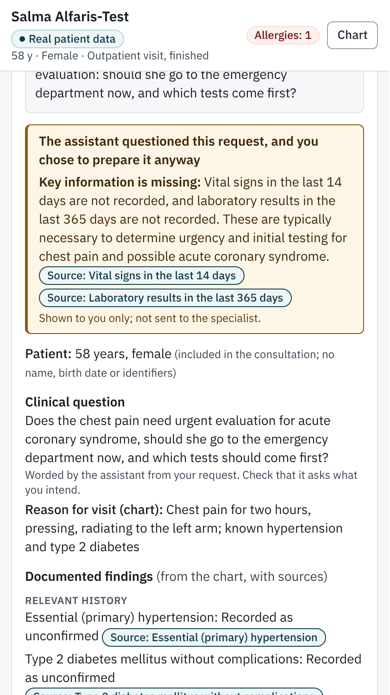 |  |  |

**The work areas in Arabic, 420 px.** The same sequence with the panel in Arabic: a request typed in Arabic, the real model's draft (it drafted at once in this run; in an earlier run it asked English questions first), the approval dialog (the destination list is the tenant's own, so its name is data), the delivery panel after approval, the History tab, and the microphone refusal. What the model writes (here its concerns about missing information and its suggestions) came back in English; it is shown as written, left to right inside the right-to-left page (see the findings below).

| Composer | The draft | Approval dialog |
| --- | --- | --- |
| 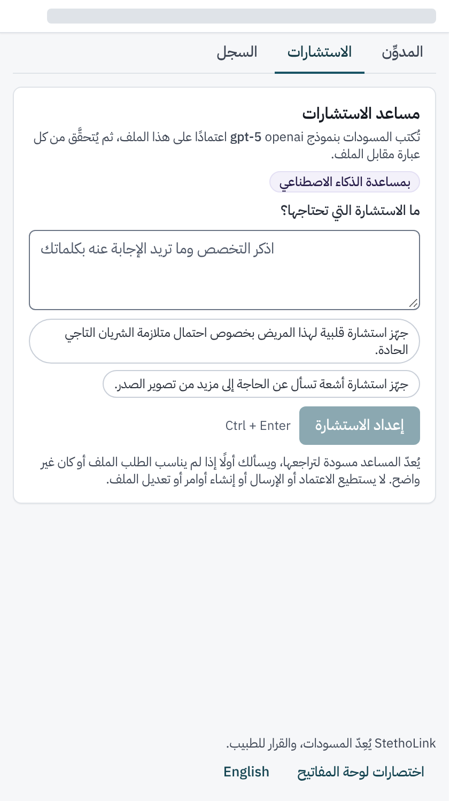 | 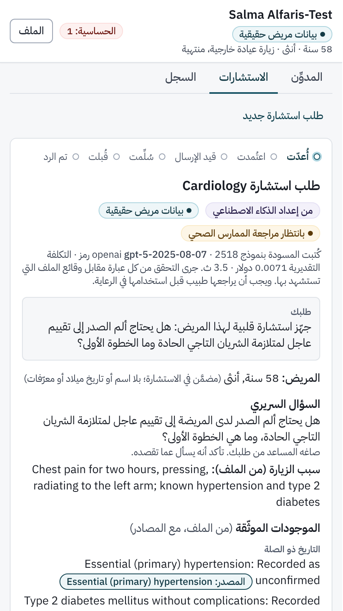 | 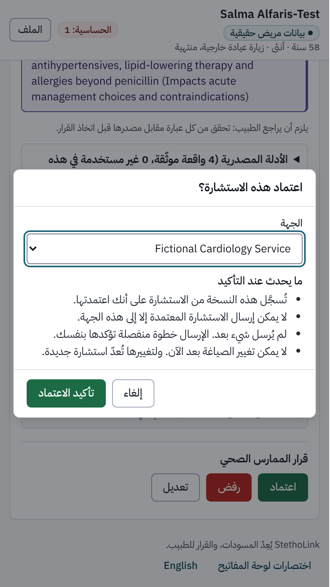 |

| After approval | History | Microphone not allowed in the frame |
| --- | --- | --- |
| 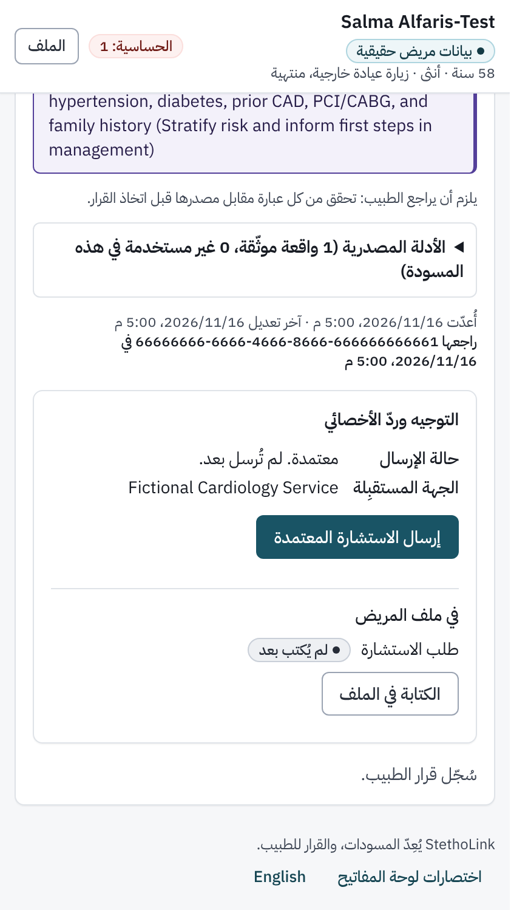 | 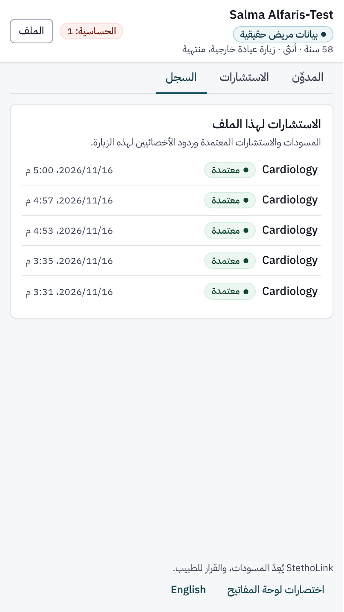 | 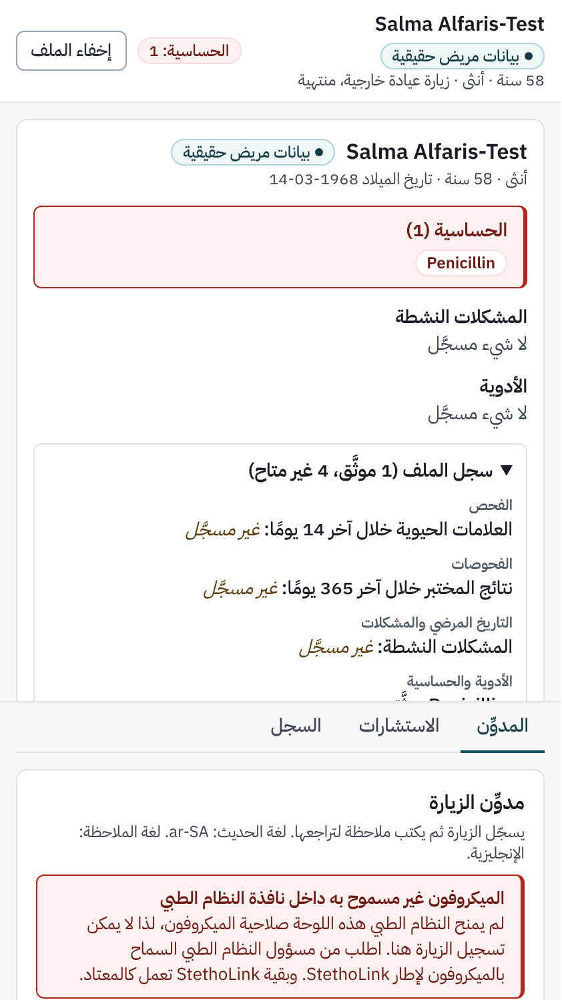 |

**What these screenshots do not show, and what they show wrongly**

- **Not shot inside OpenEMR:** recording and the scribe's note, the specialist's inbox and reply, the send confirmation, writing to the chart. They need a specialist session, a microphone allowed in the frame and the write-back, which is T7's run. The older screenshots of those screens are in `archive-staging/` (synthetic staging, before T3) and are not evidence about a real EHR.
- **Fixed while taking these screenshots:** the first set showed "Active problems" and "Medications" as "None recorded" and the draft said that active medication orders were "not recorded", although the test patient has two active problems and a medication in OpenEMR. OpenEMR 7.0.3 answers `Condition?clinical-status=active` and `MedicationRequest?...&_include=MedicationRequest:medication` with an empty bundle. The connector now asks again with fewer filters when an answer is empty (`integrations/fhir/connector.ts`, `searchWithFallback`), and the screenshots above were taken after that change: the chart lists the two problems and the medication, and the draft cites them.
- **"Reviewed by" shows the clinician's identifier** (the UUID from `SMART_CLINICIAN_MAP`), not a name. Noticed, not changed.
- **The model writes in English.** Asked in Arabic, the model's questions, its missing-information sentences and its suggestions came back in English. They are data and are shown as written; whether the prompt should ask it to answer in the physician's language is a product decision that was not made here.
- The scribe's recording and note, the specialist's inbox and the send confirmation are translated and covered by tests, but were not shot inside OpenEMR (see above).

```bash
OPENEMR_URL=https://localhost:9300 OPENEMR_USER=admin OPENEMR_PASS=<password> APP_ORIGIN=https://127.0.0.1:3082 APP_NAME=StethoLink \
OPENEMR_PID=1 VISIT=<encounter number> FRAME_WIDTH=360 UI=ar SHOTS=out NODE_PATH=/opt/node-tools/node_modules \
node tests/e2e/browser/openemr-frame.mjs        # DRAFT=1, SCRIBE=1, EXPECT=no-visit|not-shared, BREAK_HOOK=<ms>: see the file header
```

## Orders: the Orders tab (T6, sub-step 4)

The Orders tab sits between Consultations and History (Alt + 3). A physician says what to order, reviews the drafted orders with their checks in words, approves or rejects each one, and writes the approved orders to the chart or, where the EHR cannot take them, enters them by hand from text the panel offers. How it behaves is in [orders.md](../orders.md), "On the screen".

**How these were taken.** Inside the real OpenEMR 7.0.3 frame, as the screenshots above: `tests/e2e/browser/openemr-frame.mjs` with `ORDERS=1`, Chromium 153 at 2x, the production build, the app on another site than OpenEMR (`COOKIE_MODE=embedded`), the fictional patient made inside that OpenEMR (a penicillin allergy, two active problems, metformin, a visit). The hospital's catalog is the **fictional** one of `tests/fixtures/order-catalog.ts`, written to a file for `ORDER_CATALOG_FILE` (a CBC, a chest X-ray, amoxicillin and others; no real clinical content). The model was OpenAI `gpt-5` at low reasoning effort through this environment's proxy, behind the de-identification layer, a few cents for each run. The registration held no create scope and OpenEMR 7.0.3 has no `ServiceRequest` and a read-only `MedicationRequest`, so the write was answered "unsupported" for each order (the server's log line says so) and nothing reached OpenEMR.

**English, 420 px: from the request to the text to enter**

| The tab | The draft | The allergy, in words | Acknowledgement and reason |
| --- | --- | --- | --- |
| 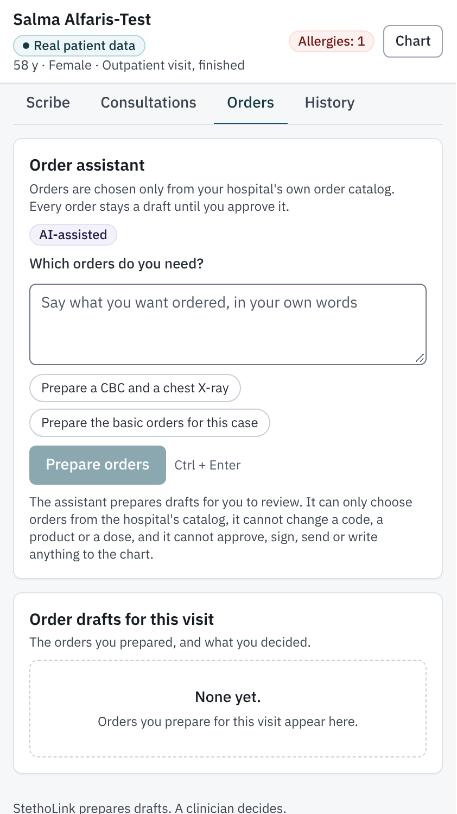 | 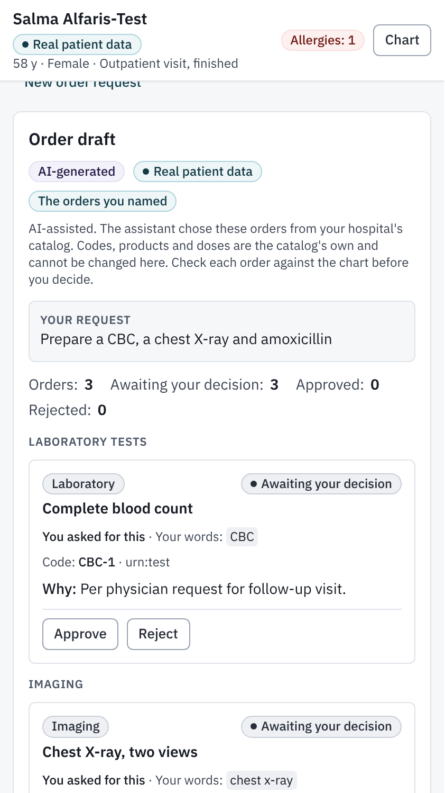 | 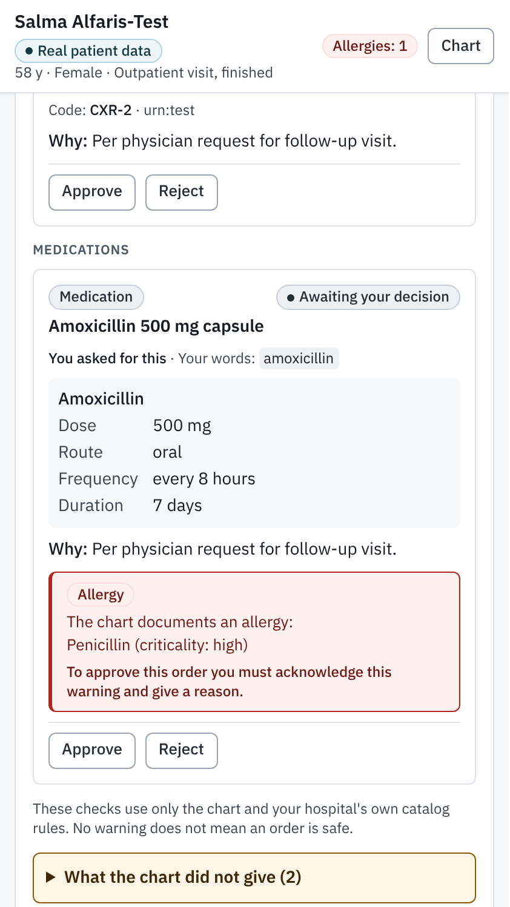 | 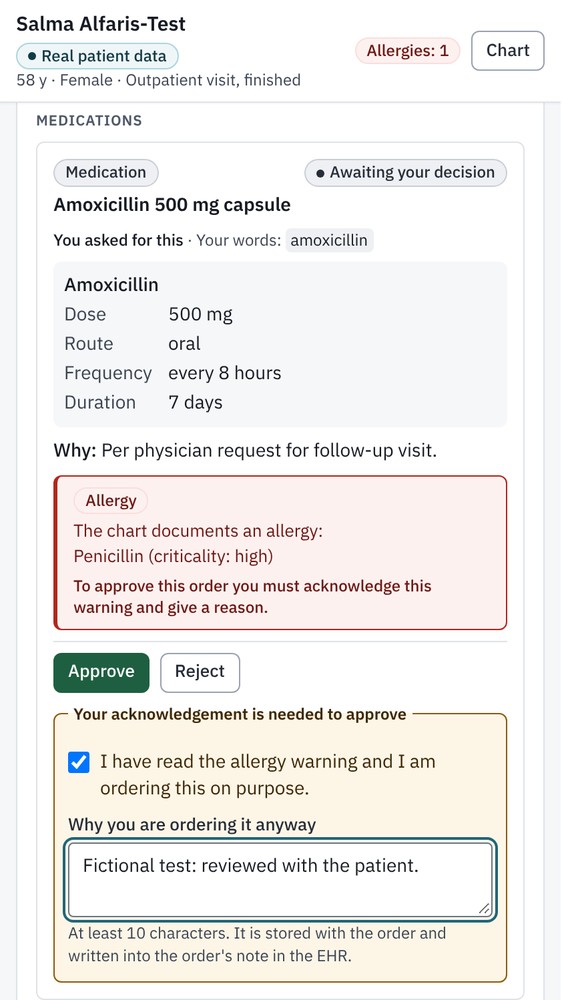 |

| Confirming the decisions | After the decisions | The EHR cannot receive the orders |
| --- | --- | --- |
| 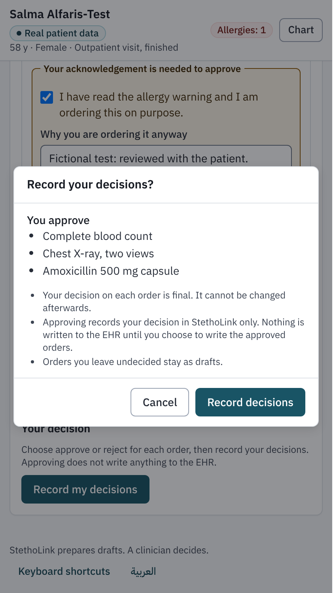 | 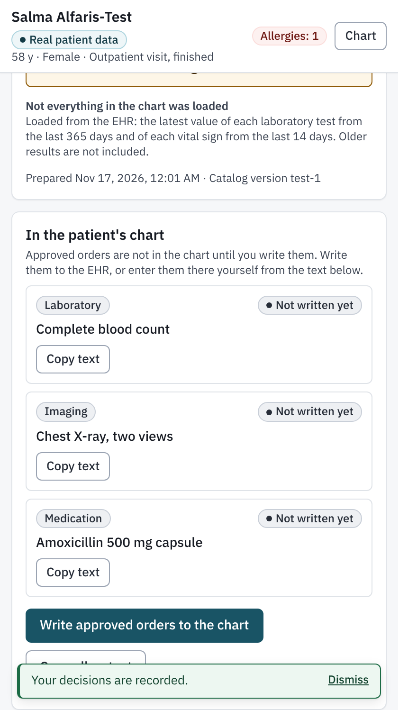 | 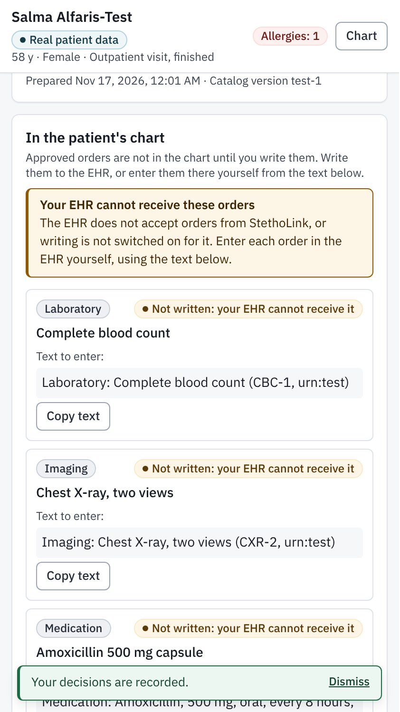 |

**Arabic (right to left), 360 px: the same walk**

| The tab | The draft | The allergy, in Arabic | Acknowledgement and reason |
| --- | --- | --- | --- |
| 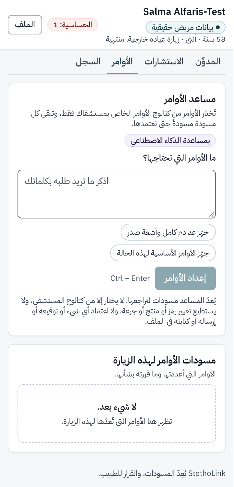 | 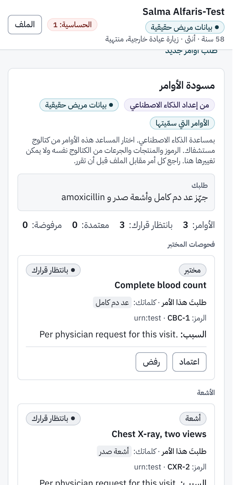 | 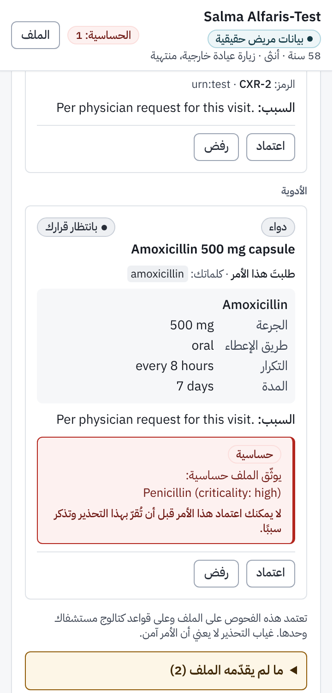 | 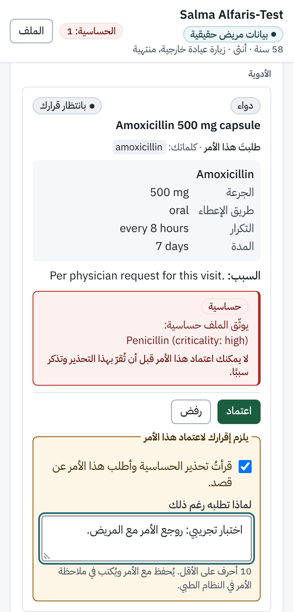 |

| Confirming the decisions | After the decisions | The EHR cannot receive the orders |
| --- | --- | --- |
| 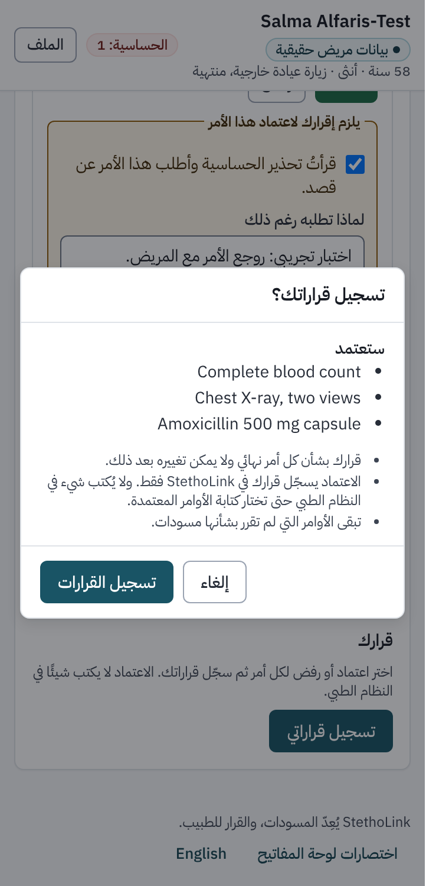 | 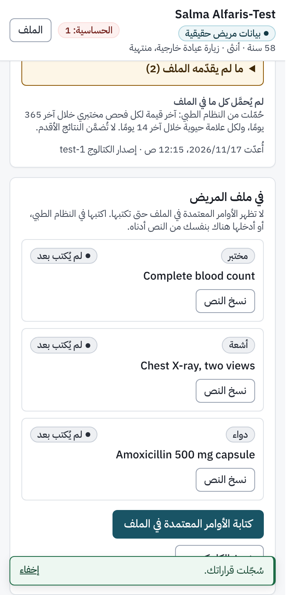 | 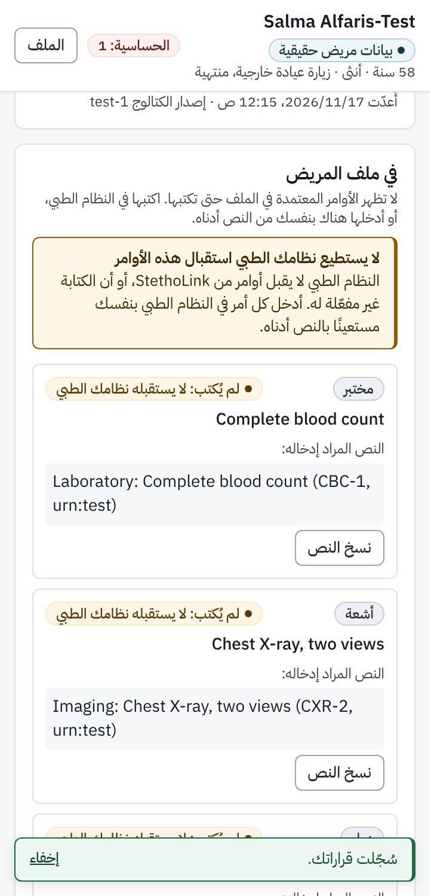 |

**States, 360 px**

| Nothing in the catalog matched (the request "an MRI of the knee") | No catalog configured on the server (501) |
| --- | --- |
| 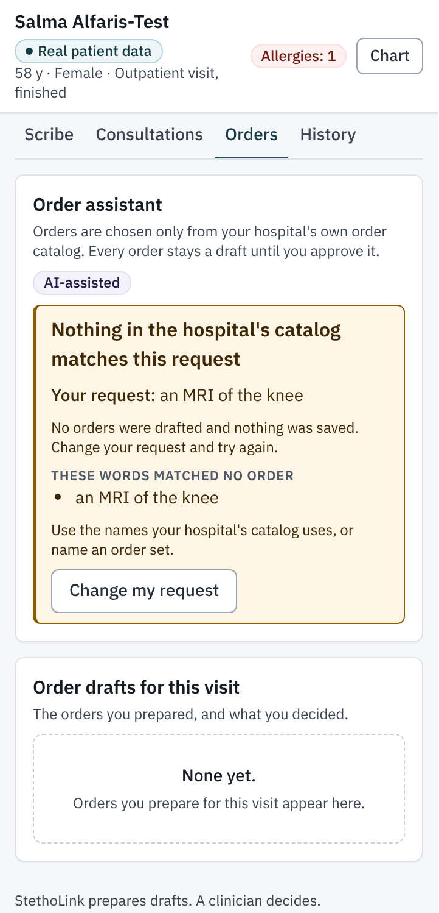 | 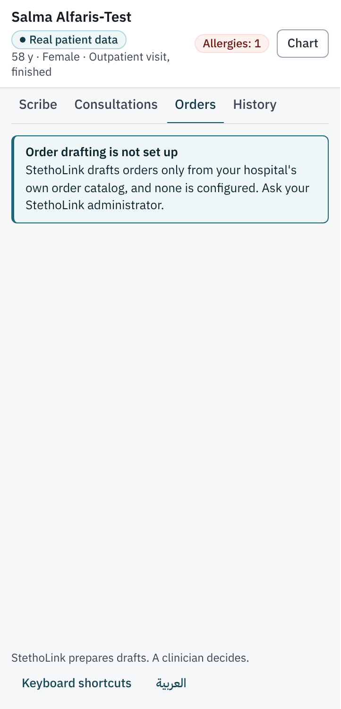 |

- *What each shows:* the request box with the two examples and the earlier drafts of the visit; the draft with the orders grouped by kind, each with who asked ("You asked for this", with the physician's words), the catalog's own code and dose, and its checks; the allergy flag in words with the chart fact it cites and the line that says an acknowledgement and a reason are needed; the acknowledgement box and the reason field that appear when Approve is chosen for that order; the confirmation, which says that the decision is final and that nothing is written to the EHR yet; the approved orders with the "Your EHR cannot receive these orders" notice and, for each, the text to enter and a Copy button (the Copy-all button put the text on the clipboard inside OpenEMR's frame: the run printed "Copied"); and the two empty states.
- *The allergy check on a real chart.* The first run in this OpenEMR showed **no** allergy flag on the amoxicillin although the chart lists a penicillin allergy: OpenEMR 7.0.3 sends a free-text allergy with the code "unknown" and keeps its name only in the resource's narrative, so StethoLink called it "Unknown" and the catalog's allergy words did not match it. The connector now reads the name from the narrative (`integrations/fhir/facts.ts`, with a test built from the resource OpenEMR renders); the screenshots above were taken after that change. A coded problem with no display text is still dropped (an open item of the handoff).
- *Arabic:* the screen builds each check's sentence from its kind, its severity and the labels of the chart facts it cites, so no English sentence of the server is shown; a name or a value the catalog, the chart or the model wrote (a medicine, a fact such as "Penicillin (criticality: high)", the assistant's reason, which came back in English) is shown as written, in its own direction. A chart value inside a sentence is kept in one piece so that it does not break across two lines.
- *Not shot inside OpenEMR:* the view of a clinician who is not a physician (no decision or write control; it is in the fake-EHR browser step of `tests/e2e/live-ehr-flow.mts`, `orders-nurse.png`), the write to an EHR that accepts orders (only a fake FHIR server took it), the decision dialog for a major interaction (the fictional chart has no active anticoagulant in OpenEMR; the same dialog is the allergy one), the screens in a hospital's own OpenEMR.

## Problems found in the old interface

1. **One endless page.** At 360 px the draft screen was 5,190 px tall: chart, visit, request, draft, sources, revision and decision in a single scroll, with no way to move between them.
2. **The patient scrolled away.** Name, age and the synthetic label were at the top only; three screens down nothing said whose chart this was or whether the data was real.
3. **The chart was shown twice** (problem and medication lists, then the same facts again in "Chart record"), and always open, pushing the work below the fold.
4. **No structure for other work.** There was nowhere to put the scribe or the history; past consultations were a list at the bottom of the request form.
5. **Irreversible actions were confirmed by a second small button**, with no statement of what approving or sending does or what the specialist receives.
6. **Waiting for the model was a single sentence** ("This can take up to two minutes") with no progress and no way to stop.
7. **Inconsistent controls.** Three button styles (utility classes, a CSS module, bare borders), five box styles with heavy coloured borders, and status shown as pictographs (flag, warning sign, pencil, bullets).
8. **Errors repeated the server's wording** ("Durable hospital consultation delivery is not configured") instead of saying what the clinician should do.
9. **System fonts only**, with no Arabic face, and physical left/right spacing that would not mirror for an Arabic interface.
10. **Source evidence was a long open list** between the draft and the decision, although it is needed only when a source is opened.

## What changed

| Area | Now |
| --- | --- |
| Layout | A sticky patient bar (name, age, sex, visit, real or synthetic data, allergy state) and four tabs: Scribe, Consultations, Orders, History. Works from a 360 px side panel to a full window. The chart record opens under the bar on demand. |
| Design tokens | `apps/embedded-app/app/globals.css`: one calm primary, cool neutrals, four semantic colours and a separate colour for AI-written content; spacing, radius, light shadows and one focus ring. Text and boundary contrasts are checked against WCAG 2.2 AA in `tests/frontend/design-tokens.test.ts`. |
| Font | IBM Plex Sans Arabic (Latin and Arabic), served by the application through `next/font/local`. Nothing is loaded from another origin. |
| Components | `apps/embedded-app/components/ui/`: Button, Card, Badge, Tabs, Dialog, ConfirmDialog, Toast, Skeleton, EmptyState, Alert, Textarea, Select, Tooltip, SegmentedControl, WorkInProgress. No new dependency. |
| AI content | Marked with an "AI-generated" or "AI-assisted" badge; each statement keeps its source chip, and one press opens and highlights the source. |
| Irreversible actions | Approve, reject, reopen and send each open a dialog that states exactly what happens. The send dialog lists what the specialist receives and what is not sent. |
| Waiting | Progress with elapsed time, the current step, a skeleton of the result and Cancel. A cancelled request can be repeated safely (same idempotency key). |
| Errors | Say what happened and what to do next (session ended, assistant unavailable, not set up for this hospital, changed elsewhere). |
| Keyboard | Alt+1/2/3/4 switch tabs, Ctrl+Enter submits the text being typed, Esc closes a dialog, `?` lists the shortcuts. Tabs follow the WAI-ARIA pattern. |
| Language and right to left | English or Arabic. The panel shell, the chart views, the launch error page and the error texts are translated; the clinician switches with the button at the bottom of the panel (remembered in a cookie) and `UI_DEFAULT_LOCALE` sets the hospital's default. `dir` is on the root element, every spacing and border is logical (a test fails on a physical `left`/`right`), and names, chart entries and references keep their own direction (`bdi`, `dir="auto"`, `dir="ltr"` for references and keys). The three work areas (Scribe, Consultations with the approval and delivery panels, History) and the specialist's inbox are translated too (`apps/embedded-app/i18n/work.ts`); a test fails if a text a person reads is written in a component instead of the dictionary, and the sentences StethoLink's own connector and core write into the chart view and the draft (fact labels, chart notes, the missing-information lines, the age) are translated by `i18n/chart-text.ts` and pinned to the real connector output. What the model, the EHR or a specialist wrote stays as written. |
| States | Loading (skeleton, then progress with Cancel), no open visit (the launch page, with its reference), a part of the chart the EHR did not grant (named, in the patient bar and the chart), an error from the server (the explanation and, for a server-side failure, the reference of its log line), a microphone the EHR frame does not allow. |
| Inside the EHR | No popup, window or tab: the scribe's "Open in a new window" button is gone. Every response carries `frame-ancestors <EHR origin>` and a policy that lets the page load and call only its own origin. See [openemr.md, 5a](../openemr.md). |

No safety logic changed: the same server checks decide who may draft, approve and send.

## Before and after (synthetic staging, before T3: not from an EHR)

These pairs were taken on the synthetic staging mode with the deterministic stand-ins, before it was removed. They show the layout change of the redesign; the labels on them ("Synthetic data", "No AI inference") cannot appear in the product any more.

| Screen | Before (360) | After (360) |
| --- | --- | --- |
| Chart and request |  |  |
| Draft with sources |  |  |
| Approval |  |  |
| Specialist response | 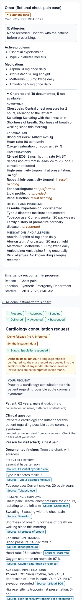 |  |

| Screen | Before (1280) | After (1280) |
| --- | --- | --- |
| Chart and request |  |  |
| Draft with sources |  |  |
| Approval | 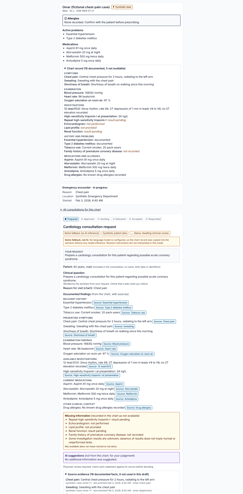 |  |
| Specialist response |  |  |

Send confirmation (new): 

Tall screens are cropped to the first 2,600 px.

## Scribe and specialist inbox (older screenshots, not from an EHR)

These were taken before T3 on the synthetic staging and on the fake-EHR flow, in the folder `archive-staging/`. The scripts that took them (`consultation-flow.mjs`, `scribe-flow.mjs`) were deleted with the staging mode. Retaking them inside OpenEMR needs the scribe's microphone and the specialist's sign-in, which is part of T7.

These screens did not exist before the redesign, so there is no "before". Captured on 2026-11-15, after Phase 5.

Scribe, 360 px, synthetic staging with Chromium's fake microphone (`tests/e2e/browser/scribe-flow.mjs`). The transcription and the note are the deterministic stand-ins, labelled on screen; they show the workflow, not transcription or note quality.

| Consent before recording | Recording | Note with sources |
| --- | --- | --- |
|  | 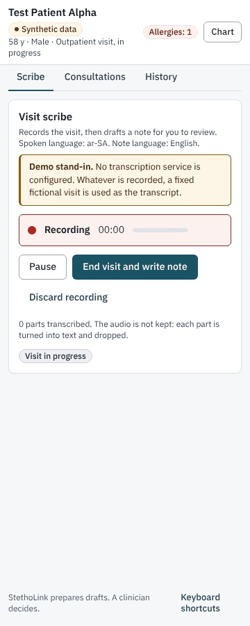 |  |

| Approval dialog | Result |
| --- | --- |
|  |  |

Specialist inbox and the physician's live workspace, 420 px, from the `LIVE_E2E_BROWSER=1` step of `tests/e2e/live-ehr-flow.mts`: the live code path against fake SMART, FHIR, transcription and model servers, with one invented patient. No real EHR is involved.

| Inbox | One request and the reply | Physician's view: reply and chart status |
| --- | --- | --- |
| 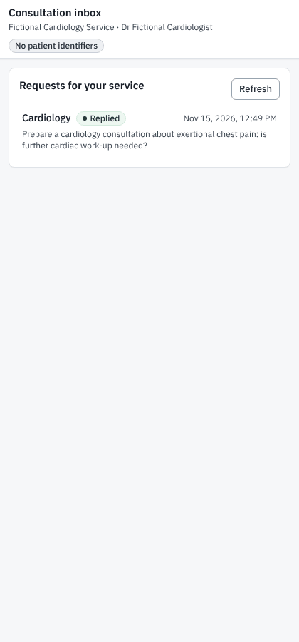 | 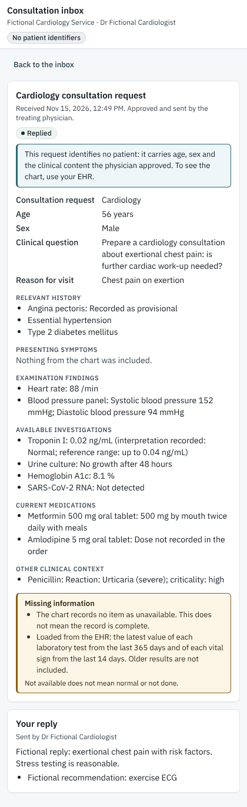 |  |

Only the `LIVE_E2E_BROWSER=1` step of `tests/e2e/live-ehr-flow.mts` still exists (fake EHR, fake model, one invented patient), and it saves `inbox-list.png`, `inbox-request.png` and `live-consultation.png` to `BROWSER_SCREENSHOT_DIR`.
