# Interface: the embedded panel inside the EHR

> **Status (OpenEMR brief, T5, 2026-11-16).** The screenshots in `after/` were taken **inside a real OpenEMR 7.0.3 frame** (Docker), not on the synthetic staging that the older ones came from. What they show and what they do not is below. The old staging screenshots are kept in [`archive-staging/`](archive-staging/) with their own note, because the staging mode (and the labels "Synthetic data" and "No AI inference" on them) no longer exists.

## Screenshots taken inside OpenEMR

**How.** `tests/e2e/browser/openemr-frame.mjs` signs in to OpenEMR 7.0.3, opens the chart of a patient created in that OpenEMR for testing (fictional: a name, an allergy, two problems, one medication, a visit), presses the app's own **Launch** button, signs in and authorizes in OpenEMR's own pages, and captures the frame OpenEMR opens. StethoLink was the production build; Chromium 153 (Playwright), 2x pixel density; the frame was narrowed to 360 or 420 CSS pixels for the narrow shots (the script checks that the page then has no sideways scroll). The registration was a different site from OpenEMR (`127.0.0.1` against `localhost`), so the session cookie was `SameSite=None; Secure; HttpOnly; Partitioned` (`COOKIE_MODE=embedded`). The same script checked on every run that no window or tab opened, that StethoLink asked for nothing outside its own origin and that every response carried the policy; the commands are in [openemr.md, 5a](../openemr.md).

**The panel inside the OpenEMR window**

| 1280 px window | 360 px panel in the same window |
| --- | --- |
|  | 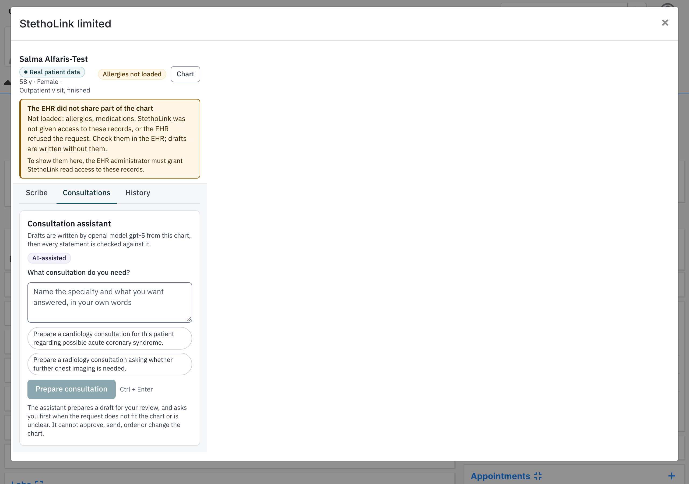 |

**Chart and work area, 360 px, English and Arabic (right to left)**

| English, chart open | Arabic, chart open | English | Arabic |
| --- | --- | --- | --- |
| 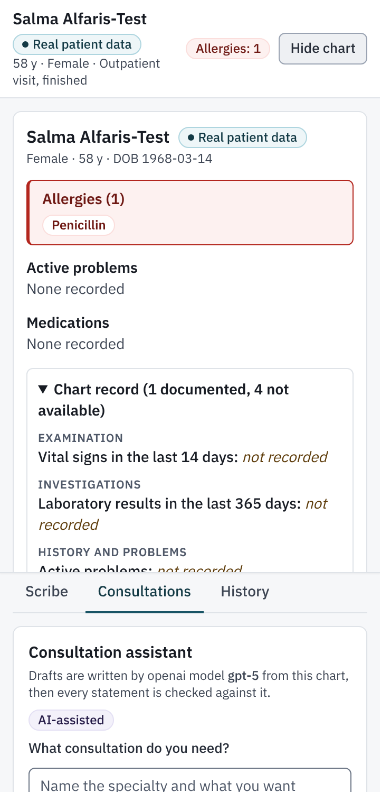 | 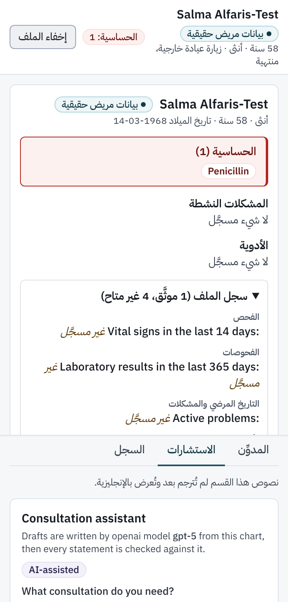 | 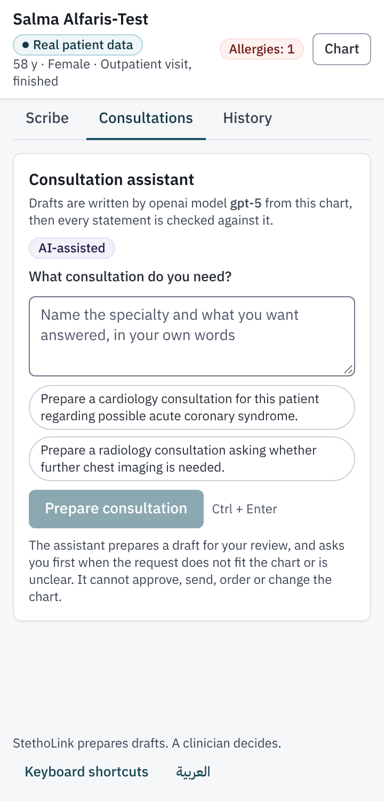 |  |

Wide (the full width of OpenEMR's dialog): 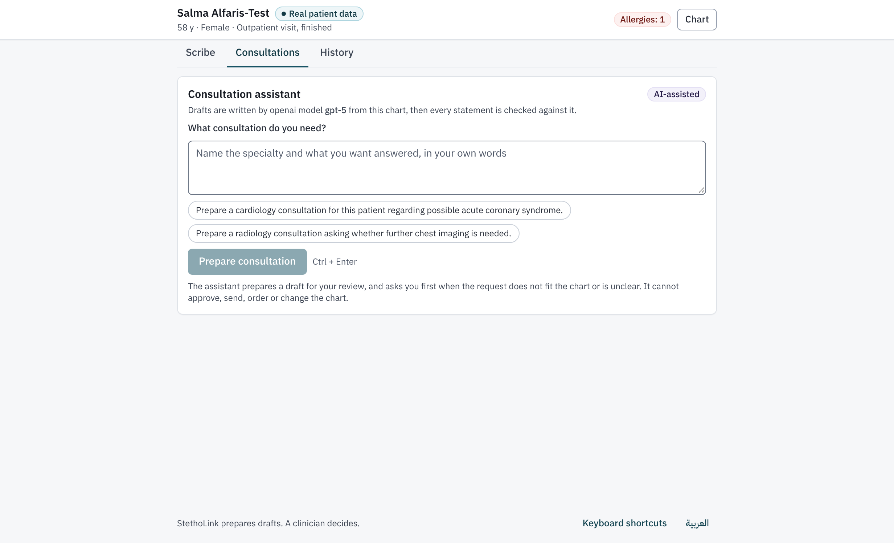

**States**

| No open visit (English) | No open visit (Arabic) | A part of the chart the EHR did not grant | The same, Arabic |
| --- | --- | --- | --- |
| 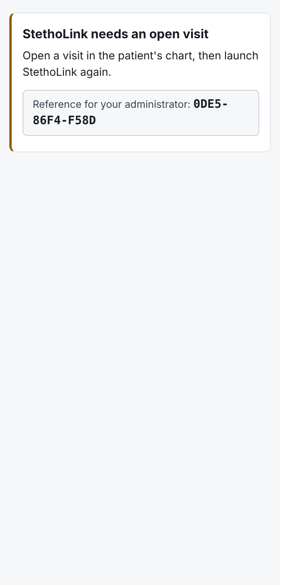 |  | 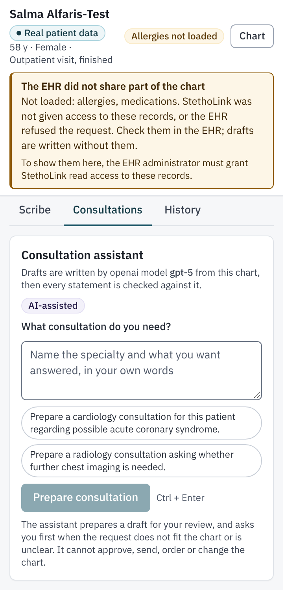 |  |

| Server error with its reference | Microphone not allowed in OpenEMR's frame |
| --- | --- |
|  |  |

- *No open visit:* the page the launch ends on when the chart has no open visit (T1). The reference is the one in the server log line.
- *Not granted:* a second SMART client was registered without `patient/AllergyIntolerance.read` and `patient/MedicationRequest.read`. The patient bar says "Allergies not loaded" and a notice names what was not loaded and who can change it; the allergy box no longer reads "None recorded".
- *Server error:* the database was stopped while the History tab was open. The server logged `api.request_failed` with the same reference (`9B2C-53AB-3CC6` in this run).
- *Microphone:* OpenEMR 7.0.3 creates the frame without `allow="microphone"`, so the browser refuses it. The panel says so and offers nothing else (it used to offer a new window).

**A consultation from the real model, 420 px.** The visit reason says chest pain; the request was typed in the panel; the model was OpenAI `gpt-5` through the de-identification layer (T4), a few cents for the whole sequence. It asked twice before drafting (the first answer was vague), then "Prepare anyway" drafted it with its doubts kept visible. Approval needs a mapped physician, a destination from the tenant's list and a confirmation that says what it does; nothing was sent to a specialist.

| The assistant questions the request | The draft | Approval dialog | After approval |
| --- | --- | --- | --- |
|  |  | 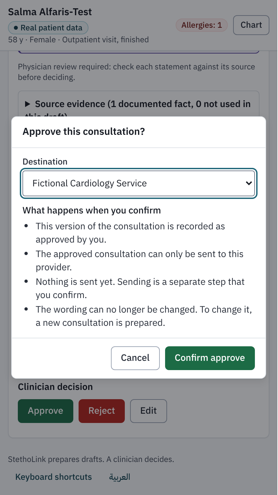 | 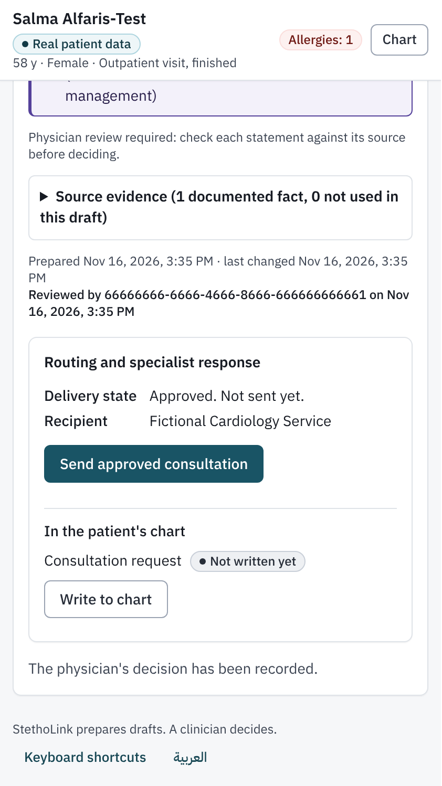 |

**What these screenshots do not show, and what they show wrongly**

- **Not shot inside OpenEMR:** recording and the scribe's note, the specialist's inbox and reply, the send confirmation, writing to the chart. They need a specialist session, a microphone allowed in the frame and the write-back, which is T7's run. The older screenshots of those screens are in `archive-staging/` (synthetic staging, before T3) and are not evidence about a real EHR.
- **The chart looks emptier than the EHR's.** In these shots "Active problems" and "Medications" read "None recorded" and the draft says that active medication orders are "not recorded", but the test patient has two active problems and a medication in OpenEMR. StethoLink asks `Condition?clinical-status=active` and `MedicationRequest?status=active&_include=MedicationRequest:medication`; OpenEMR 7.0.3 answers `200` with an empty bundle (it does not support `clinical-status` on `Condition`, and the medication search was also empty over HTTP). This is a fault of the chart reads, found while taking these screenshots and **not fixed** here; see the handoff. The allergy list loaded.
- **"Reviewed by" shows the clinician's identifier** (the UUID from `SMART_CLINICIAN_MAP`), not a name. Noticed, not changed.
- The Scribe, Consultations and History work areas are English even when the shell is Arabic (see "What changed").

```bash
OPENEMR_URL=https://localhost:9300 OPENEMR_USER=admin OPENEMR_PASS=<password> APP_ORIGIN=https://127.0.0.1:3082 APP_NAME=StethoLink \
OPENEMR_PID=1 VISIT=<encounter number> FRAME_WIDTH=360 UI=ar SHOTS=out NODE_PATH=/opt/node-tools/node_modules \
node tests/e2e/browser/openemr-frame.mjs        # DRAFT=1, SCRIBE=1, EXPECT=no-visit|not-shared, BREAK_HOOK=<ms>: see the file header
```

## Problems found in the old interface

1. **One endless page.** At 360 px the draft screen was 5,190 px tall: chart, visit, request, draft, sources, revision and decision in a single scroll, with no way to move between them.
2. **The patient scrolled away.** Name, age and the synthetic label were at the top only; three screens down nothing said whose chart this was or whether the data was real.
3. **The chart was shown twice** (problem and medication lists, then the same facts again in "Chart record"), and always open, pushing the work below the fold.
4. **No structure for other work.** There was nowhere to put the scribe or the history; past consultations were a list at the bottom of the request form.
5. **Irreversible actions were confirmed by a second small button**, with no statement of what approving or sending does or what the specialist receives.
6. **Waiting for the model was a single sentence** ("This can take up to two minutes") with no progress and no way to stop.
7. **Inconsistent controls.** Three button styles (utility classes, a CSS module, bare borders), five box styles with heavy coloured borders, and status shown as pictographs (flag, warning sign, pencil, bullets).
8. **Errors repeated the server's wording** ("Durable hospital consultation delivery is not configured") instead of saying what the clinician should do.
9. **System fonts only**, with no Arabic face, and physical left/right spacing that would not mirror for an Arabic interface.
10. **Source evidence was a long open list** between the draft and the decision, although it is needed only when a source is opened.

## What changed

| Area | Now |
| --- | --- |
| Layout | A sticky patient bar (name, age, sex, visit, real or synthetic data, allergy state) and three tabs: Scribe, Consultations, History. Works from a 360 px side panel to a full window. The chart record opens under the bar on demand. |
| Design tokens | `apps/embedded-app/app/globals.css`: one calm primary, cool neutrals, four semantic colours and a separate colour for AI-written content; spacing, radius, light shadows and one focus ring. Text and boundary contrasts are checked against WCAG 2.2 AA in `tests/frontend/design-tokens.test.ts`. |
| Font | IBM Plex Sans Arabic (Latin and Arabic), served by the application through `next/font/local`. Nothing is loaded from another origin. |
| Components | `apps/embedded-app/components/ui/`: Button, Card, Badge, Tabs, Dialog, ConfirmDialog, Toast, Skeleton, EmptyState, Alert, Textarea, Select, Tooltip, SegmentedControl, WorkInProgress. No new dependency. |
| AI content | Marked with an "AI-generated" or "AI-assisted" badge; each statement keeps its source chip, and one press opens and highlights the source. |
| Irreversible actions | Approve, reject, reopen and send each open a dialog that states exactly what happens. The send dialog lists what the specialist receives and what is not sent. |
| Waiting | Progress with elapsed time, the current step, a skeleton of the result and Cancel. A cancelled request can be repeated safely (same idempotency key). |
| Errors | Say what happened and what to do next (session ended, assistant unavailable, not set up for this hospital, changed elsewhere). |
| Keyboard | Alt+1/2/3 switch tabs, Ctrl+Enter submits the text being typed, Esc closes a dialog, `?` lists the shortcuts. Tabs follow the WAI-ARIA pattern. |
| Language and right to left | English or Arabic. The panel shell, the chart views, the launch error page and the error texts are translated; the clinician switches with the button at the bottom of the panel (remembered in a cookie) and `UI_DEFAULT_LOCALE` sets the hospital's default. `dir` is on the root element, every spacing and border is logical (a test fails on a physical `left`/`right`), and names, chart entries and references keep their own direction (`bdi`, `dir="auto"`, `dir="ltr"` for references and keys). The Scribe, Consultations and History work areas are still English (a note says so in Arabic). |
| States | Loading (skeleton, then progress with Cancel), no open visit (the launch page, with its reference), a part of the chart the EHR did not grant (named, in the patient bar and the chart), an error from the server (the explanation and, for a server-side failure, the reference of its log line), a microphone the EHR frame does not allow. |
| Inside the EHR | No popup, window or tab: the scribe's "Open in a new window" button is gone. Every response carries `frame-ancestors <EHR origin>` and a policy that lets the page load and call only its own origin. See [openemr.md, 5a](../openemr.md). |

No safety logic changed: the same server checks decide who may draft, approve and send.

## Before and after (synthetic staging, before T3: not from an EHR)

These pairs were taken on the synthetic staging mode with the deterministic stand-ins, before it was removed. They show the layout change of the redesign; the labels on them ("Synthetic data", "No AI inference") cannot appear in the product any more.

| Screen | Before (360) | After (360) |
| --- | --- | --- |
| Chart and request |  | 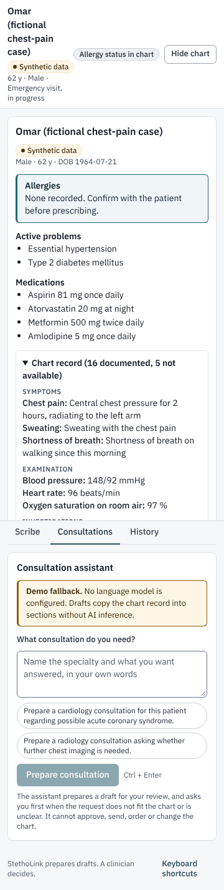 |
| Draft with sources | 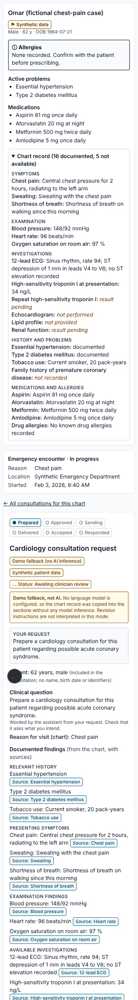 |  |
| Approval | 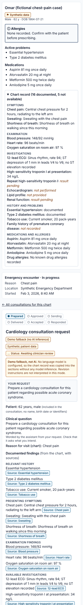 |  |
| Specialist response |  | 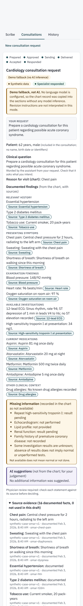 |

| Screen | Before (1280) | After (1280) |
| --- | --- | --- |
| Chart and request |  | 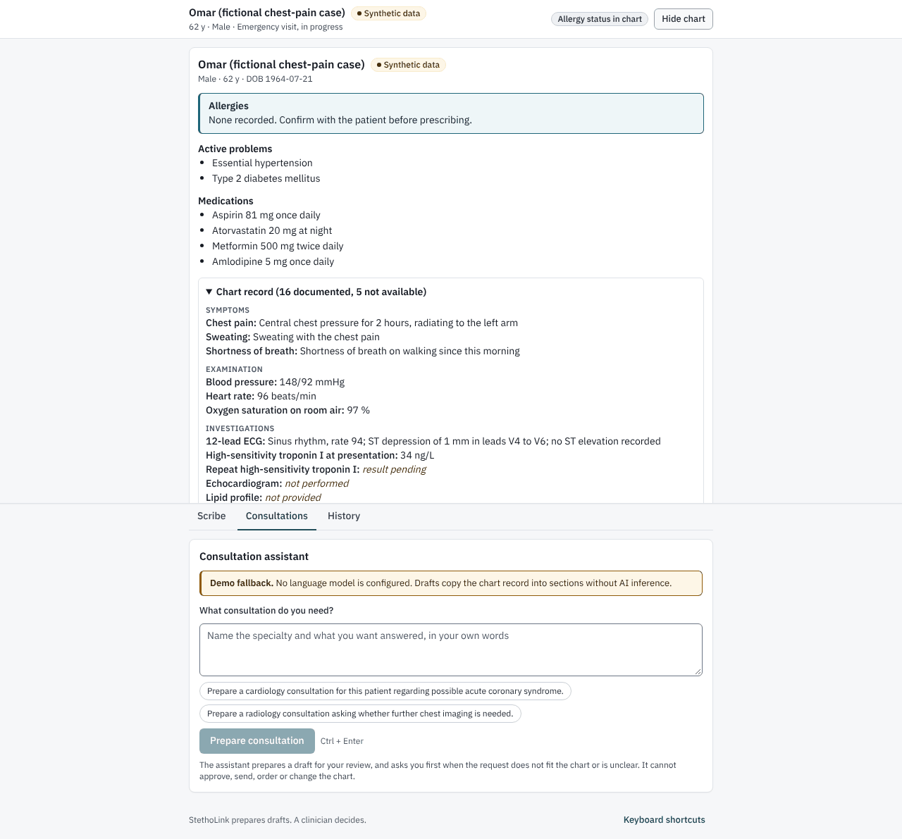 |
| Draft with sources | 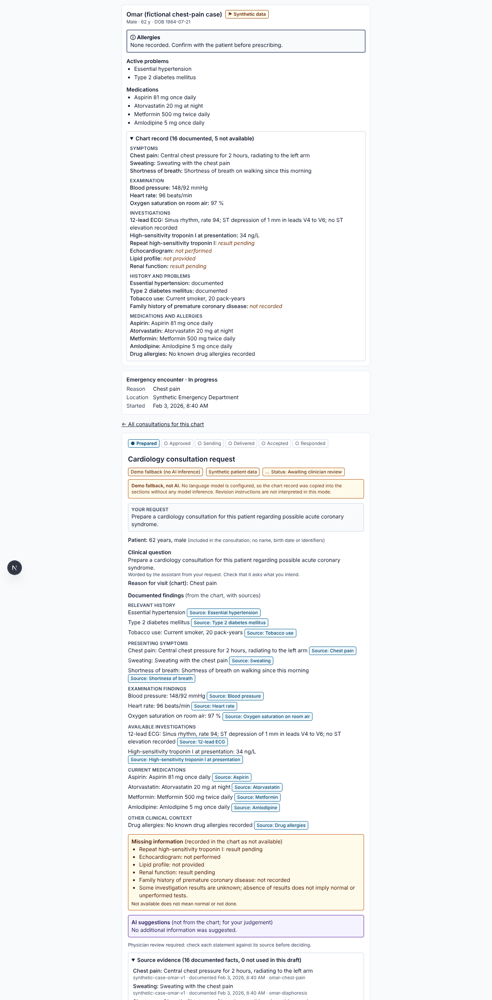 |  |
| Approval |  |  |
| Specialist response | 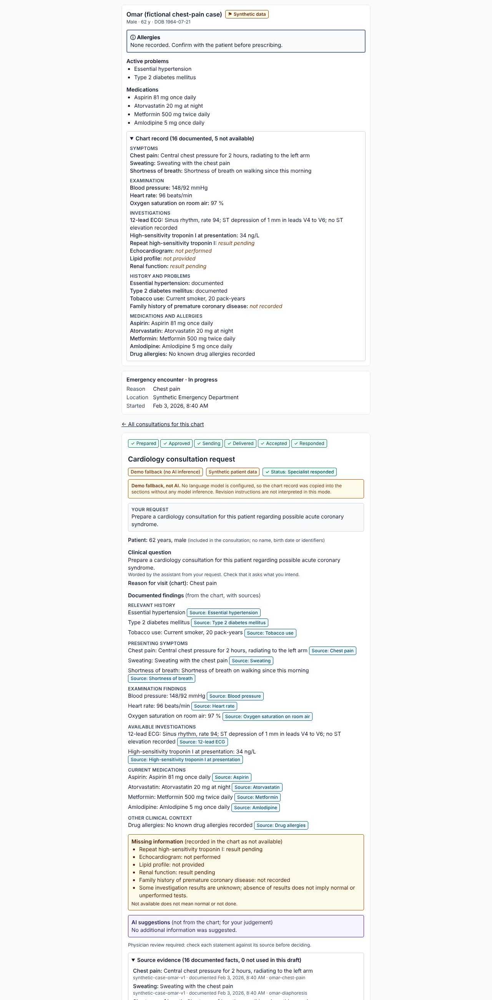 | 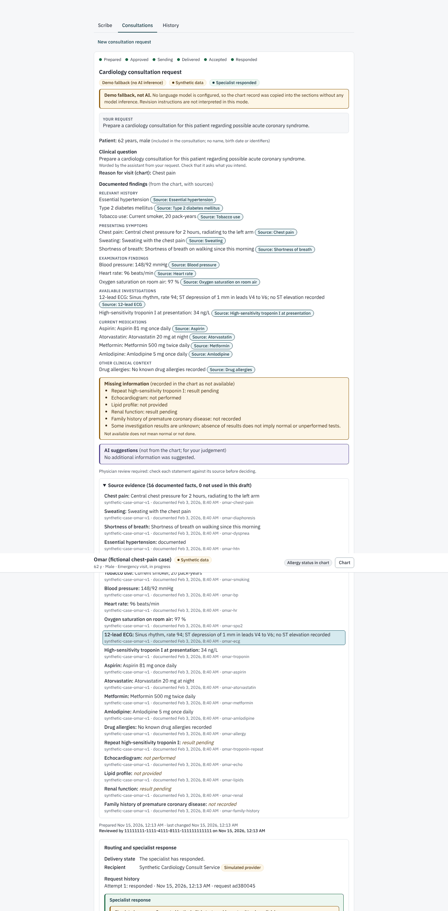 |

Send confirmation (new): 

Tall screens are cropped to the first 2,600 px.

## Scribe and specialist inbox (older screenshots, not from an EHR)

These were taken before T3 on the synthetic staging and on the fake-EHR flow, in the folder `archive-staging/`. The scripts that took them (`consultation-flow.mjs`, `scribe-flow.mjs`) were deleted with the staging mode. Retaking them inside OpenEMR needs the scribe's microphone and the specialist's sign-in, which is part of T7.

These screens did not exist before the redesign, so there is no "before". Captured on 2026-11-15, after Phase 5.

Scribe, 360 px, synthetic staging with Chromium's fake microphone (`tests/e2e/browser/scribe-flow.mjs`). The transcription and the note are the deterministic stand-ins, labelled on screen; they show the workflow, not transcription or note quality.

| Consent before recording | Recording | Note with sources |
| --- | --- | --- |
| 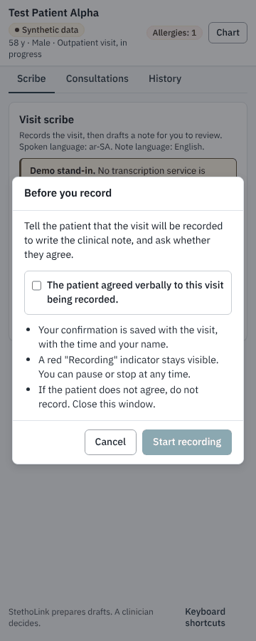 |  |  |

| Approval dialog | Result |
| --- | --- |
|  |  |

Specialist inbox and the physician's live workspace, 420 px, from the `LIVE_E2E_BROWSER=1` step of `tests/e2e/live-ehr-flow.mts`: the live code path against fake SMART, FHIR, transcription and model servers, with one invented patient. No real EHR is involved.

| Inbox | One request and the reply | Physician's view: reply and chart status |
| --- | --- | --- |
|  |  |  |

Only the `LIVE_E2E_BROWSER=1` step of `tests/e2e/live-ehr-flow.mts` still exists (fake EHR, fake model, one invented patient), and it saves `inbox-list.png`, `inbox-request.png` and `live-consultation.png` to `BROWSER_SCREENSHOT_DIR`.
