# Interface: before and after the design system

Screenshots were taken with Playwright by `tests/e2e/browser/consultation-flow.mjs` at 360, 480 and 1280 px wide, on the synthetic chest-pain chart with the deterministic fallback (no AI inference). The 360 and 1280 px captures of four screens are kept here.

```bash
STAGING_BASE_URL=http://127.0.0.1:3100 STAGING_LAUNCH_SECRET=<secret> BROWSER_WIDTH=360 BROWSER_SCALE=1 BROWSER_SCREENSHOT_DIR=out node tests/e2e/browser/consultation-flow.mjs
```

## Problems found in the old interface

1. **One endless page.** At 360 px the draft screen was 5,190 px tall: chart, visit, request, draft, sources, revision and decision in a single scroll, with no way to move between them.
2. **The patient scrolled away.** Name, age and the synthetic label were at the top only; three screens down nothing said whose chart this was or whether the data was real.
3. **The chart was shown twice** (problem and medication lists, then the same facts again in "Chart record"), and always open, pushing the work below the fold.
4. **No structure for other work.** There was nowhere to put the scribe or the history; past consultations were a list at the bottom of the request form.
5. **Irreversible actions were confirmed by a second small button**, with no statement of what approving or sending does or what the specialist receives.
6. **Waiting for the model was a single sentence** ("This can take up to two minutes") with no progress and no way to stop.
7. **Inconsistent controls.** Three button styles (utility classes, a CSS module, bare borders), five box styles with heavy coloured borders, and status shown as pictographs (flag, warning sign, pencil, bullets).
8. **Errors repeated the server's wording** ("Durable hospital consultation delivery is not configured") instead of saying what the clinician should do.
9. **System fonts only**, with no Arabic face, and physical left/right spacing that would not mirror for an Arabic interface.
10. **Source evidence was a long open list** between the draft and the decision, although it is needed only when a source is opened.

## What changed

| Area | Now |
| --- | --- |
| Layout | A sticky patient bar (name, age, sex, visit, real or synthetic data, allergy state) and three tabs: Scribe, Consultations, History. Works from a 360 px side panel to a full window. The chart record opens under the bar on demand. |
| Design tokens | `apps/embedded-app/app/globals.css`: one calm primary, cool neutrals, four semantic colours and a separate colour for AI-written content; spacing, radius, light shadows and one focus ring. Text and boundary contrasts are checked against WCAG 2.2 AA in `tests/frontend/design-tokens.test.ts`. |
| Font | IBM Plex Sans Arabic (Latin and Arabic), served by the application through `next/font/local`. Nothing is loaded from another origin. |
| Components | `apps/embedded-app/components/ui/`: Button, Card, Badge, Tabs, Dialog, ConfirmDialog, Toast, Skeleton, EmptyState, Alert, Textarea, Select, Tooltip, SegmentedControl, WorkInProgress. No new dependency. |
| AI content | Marked with an "AI-generated" or "AI-assisted" badge; each statement keeps its source chip, and one press opens and highlights the source. |
| Irreversible actions | Approve, reject, reopen and send each open a dialog that states exactly what happens. The send dialog lists what the specialist receives and what is not sent. |
| Waiting | Progress with elapsed time, the current step, a skeleton of the result and Cancel. A cancelled request can be repeated safely (same idempotency key). |
| Errors | Say what happened and what to do next (session ended, assistant unavailable, not set up for this hospital, changed elsewhere). |
| Keyboard | Alt+1/2/3 switch tabs, Ctrl+Enter submits the text being typed, Esc closes a dialog, `?` lists the shortcuts. Tabs follow the WAI-ARIA pattern. |
| Right to left | `dir` on the root element and logical CSS properties throughout. English is the default. |

No safety logic changed: the same server checks decide who may draft, approve and send.

## Before and after

| Screen | Before (360) | After (360) |
| --- | --- | --- |
| Chart and request | 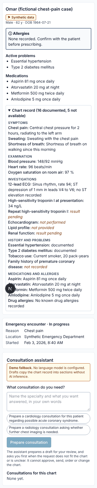 |  |
| Draft with sources |  | 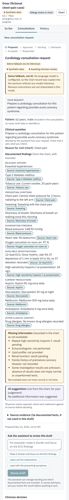 |
| Approval |  | 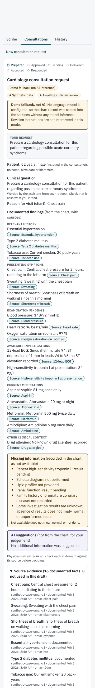 |
| Specialist response |  |  |

| Screen | Before (1280) | After (1280) |
| --- | --- | --- |
| Chart and request | 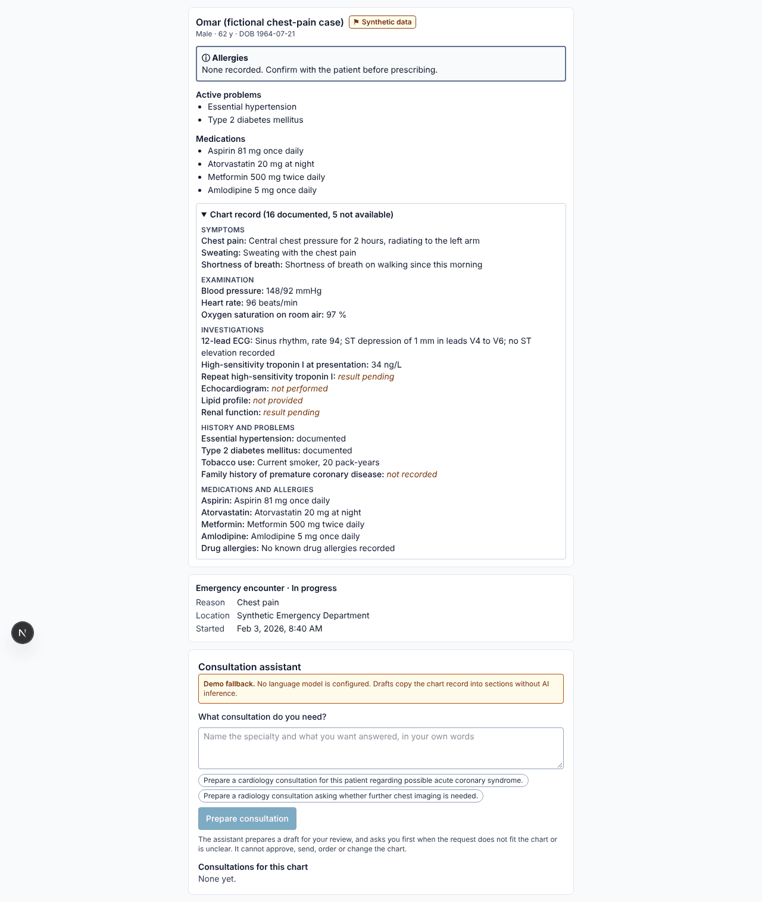 |  |
| Draft with sources |  | 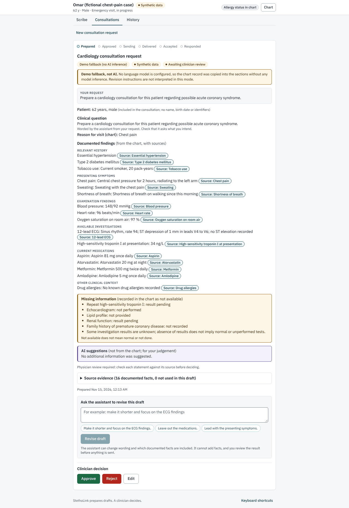 |
| Approval |  | 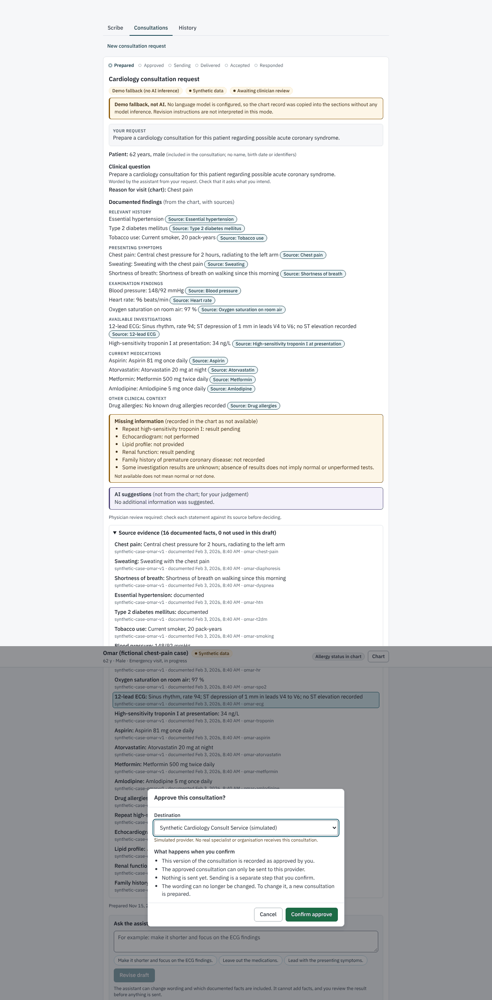 |
| Specialist response |  |  |

Send confirmation (new): 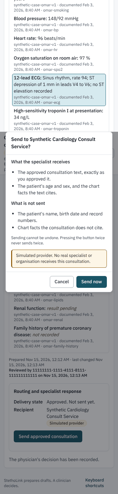

Tall screens are cropped to the first 2,600 px.

## Scribe and specialist inbox

These screens did not exist before the redesign, so there is no "before". Captured on 2026-11-15, after Phase 5.

Scribe, 360 px, synthetic staging with Chromium's fake microphone (`tests/e2e/browser/scribe-flow.mjs`). The transcription and the note are the deterministic stand-ins, labelled on screen; they show the workflow, not transcription or note quality.

| Consent before recording | Recording | Note with sources |
| --- | --- | --- |
|  |  | 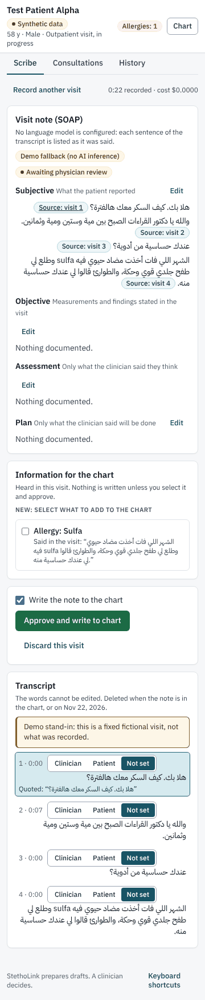 |

| Approval dialog | Result |
| --- | --- |
| 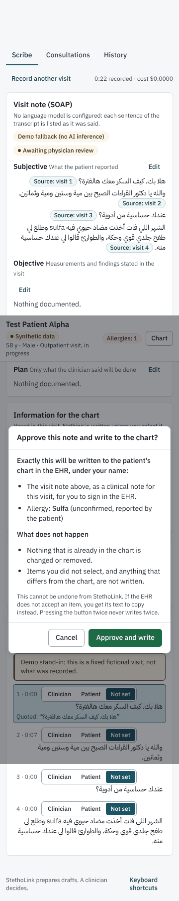 | 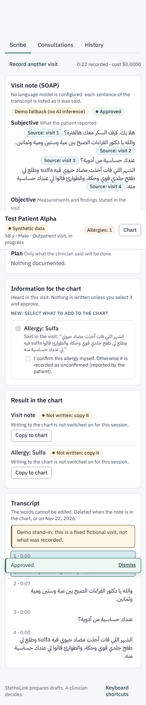 |

Specialist inbox and the physician's live workspace, 420 px, from the `LIVE_E2E_BROWSER=1` step of `tests/e2e/live-ehr-flow.mts`: the live code path against fake SMART, FHIR, transcription and model servers, with one invented patient. No real EHR is involved.

| Inbox | One request and the reply | Physician's view: reply and chart status |
| --- | --- | --- |
|  |  | 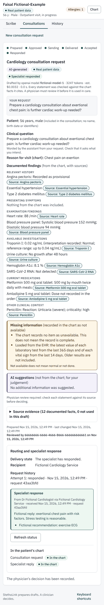 |

```bash
STAGING_BASE_URL=http://127.0.0.1:3100 STAGING_LAUNCH_SECRET=<secret> SCRIBE_FAKE_AUDIO=speech.wav BROWSER_WIDTH=360 BROWSER_SCREENSHOT_DIR=out node tests/e2e/browser/scribe-flow.mjs
LIVE_E2E_BROWSER=1 BROWSER_SCREENSHOT_DIR=out node tests/e2e/live-ehr-flow.mts
```
